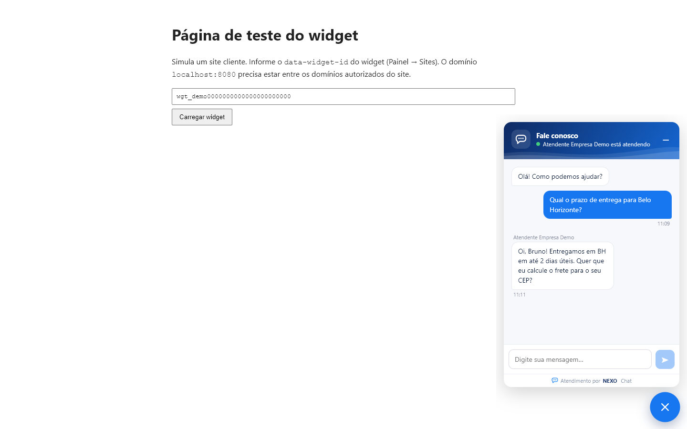
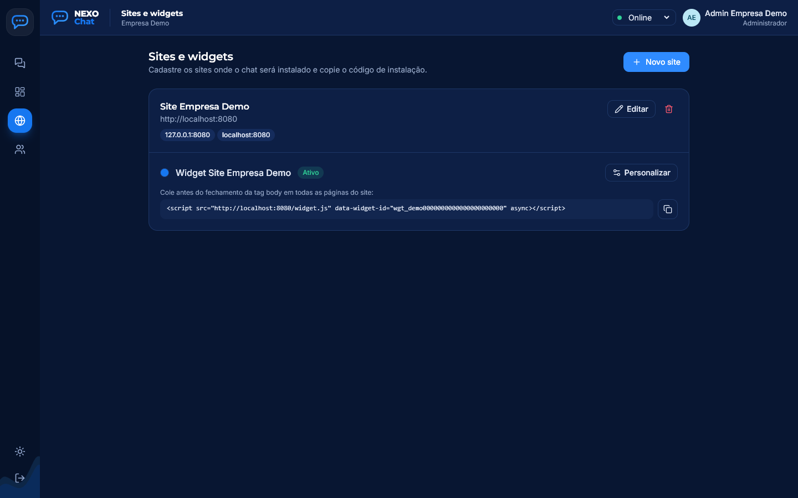
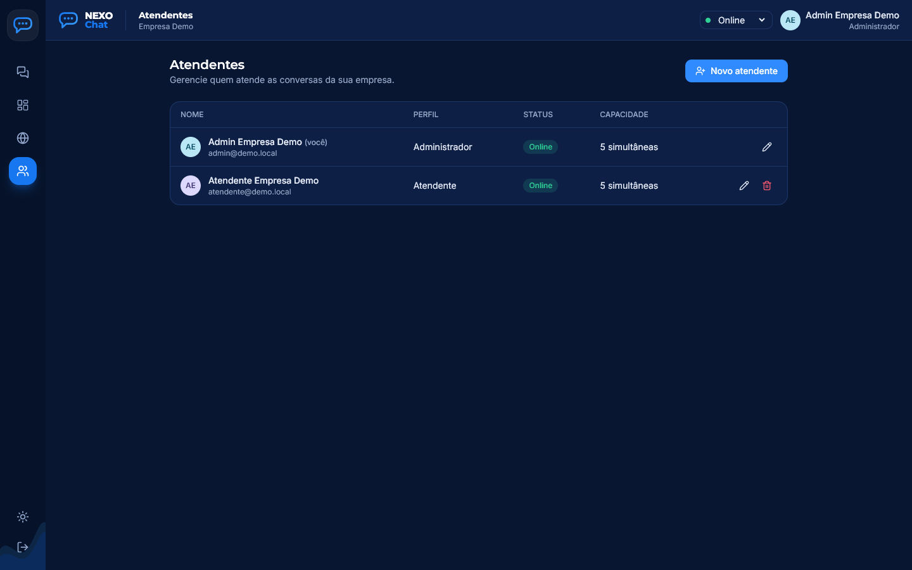
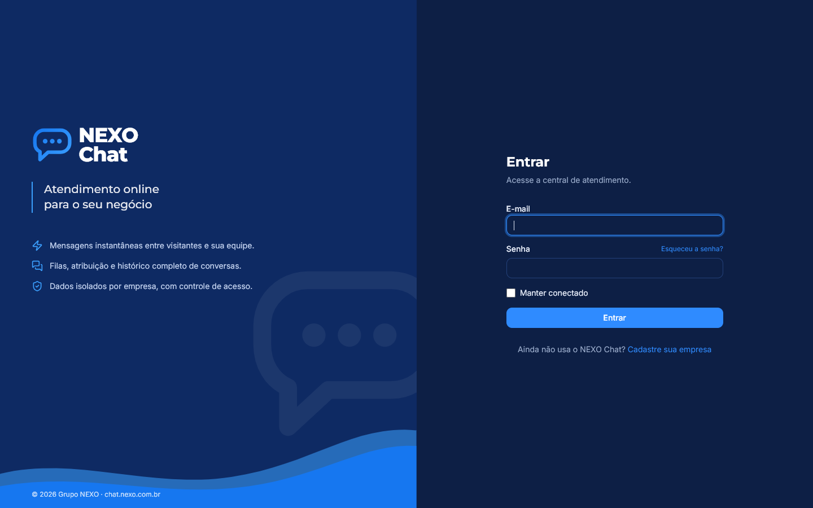
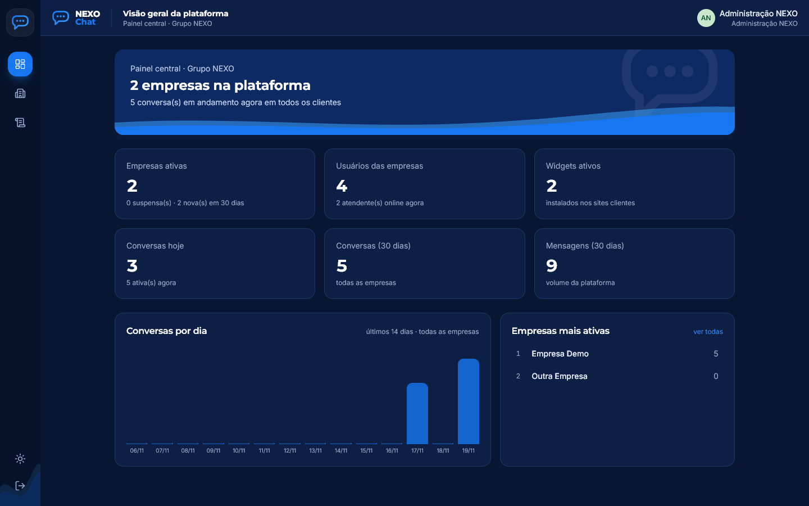
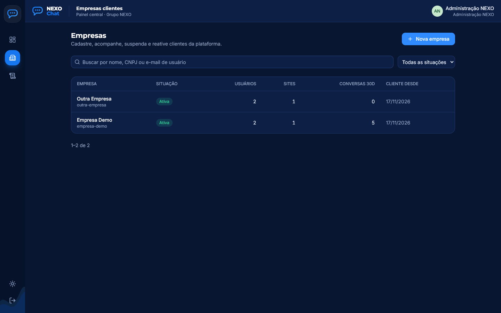

<p align="center">
  
</p>

<h1 align="center">NEXO Chat</h1>

<p align="center">
  <strong>Atendimento online para o seu negócio.</strong><br>
  Plataforma SaaS do Grupo NEXO: widget de chat para sites, central de atendimento em tempo real e painéis de gestão para cada empresa e para a NEXO.
</p>

<p align="center">
  
  
  
  
  
  
  
  
</p>


## O que é

Uma empresa cliente cadastra seus sites, cola uma linha de script e passa a receber conversas dos visitantes numa central de atendimento em tempo real. Cada empresa enxerga só os próprios dados; a NEXO acompanha e administra todas pelo painel central.

| Para quem | O que faz |
|---|---|
| **Visitante do site** | Abre o chat no canto da página, conversa e continua de onde parou mesmo recarregando a página. |
| **Atendente** | Recebe as conversas em tempo real, assume, responde, vê quando o visitante está digitando e encerra. |
| **Administrador da empresa** | Acompanha os indicadores, cadastra sites e domínios autorizados, personaliza o widget e gerencia atendentes. |
| **Administração NEXO** | Vê a plataforma inteira, cadastra, edita, suspende e reativa empresas e consulta a auditoria. |

## Telas

### Widget no site do cliente


### Central de atendimento
Fila, conversas em andamento e finalizadas, dados do visitante e mensagens em tempo real via WebSocket (imagem do topo).

### Painel da empresa

| Dashboard | Sites e widget |
|---|---|
|  |  |

| Atendentes | Login |
|---|---|
|  |  |

### Painel central NEXO

| Visão geral | Empresas |
|---|---|
|  |  |


## Destaques técnicos

- **Tempo real:** Laravel Reverb (WebSocket) com canais privados por empresa e por conversa; eventos enviados pela fila no Redis depois do commit.
- **Multiempresa seguro:** escopo global por `company_id` que falha fechado sem contexto e bloqueia gravação em outra empresa; testes de isolamento.
- **Widget isolado:** carregado num iframe, só funciona nos domínios autorizados (validação no servidor e CSP `frame-ancestors`), visitante identificado por token aleatório guardado só como hash.
- **Mensagens confiáveis:** sem duplicadas (id do cliente + índice único), ordem garantida por sequência e recuperação do que foi perdido ao reconectar.
- **Testes:** 43 testes Pest (fluxo do widget, atendimento, isolamento entre empresas, autorização dos canais, painéis) num banco separado que nunca toca o de desenvolvimento.

## Documentação

| Documento | Conteúdo |
|---|---|
| [docs/ARQUITETURA.md](docs/ARQUITETURA.md) | Arquitetura e decisões técnicas |
| [docs/STATUS.md](docs/STATUS.md) | O que já foi feito, o que falta e próximos passos |
| [docs/ESPECIFICACAO.md](docs/ESPECIFICACAO.md) | Especificação completa do produto (fases 1 a 4) |

## Requisitos

- Docker + Docker Compose (não é preciso PHP/Node instalados localmente).

## Instalação (desenvolvimento)

```bash
cp .env.example .env
docker network create nexo-net
docker compose build
docker compose run --rm app composer install
docker compose run --rm vite npm install
docker compose run --rm app php artisan key:generate
docker compose run --rm app php artisan reverb:install   # gera REVERB_APP_ID/KEY/SECRET no .env
docker compose up -d postgres redis
docker compose run --rm app php artisan migrate --seed
docker compose run --rm vite npm run build                # ou: docker compose up -d vite (HMR)
docker compose up -d app nginx reverb queue
```

| Serviço | Endereço |
|---|---|
| Aplicação | http://localhost:8080 |
| Reverb (WebSocket) | ws://localhost:8081 |
| PostgreSQL | localhost:5442 |
| Redis | localhost:6380 |
| Vite (HMR, opcional) | http://localhost:5174 |

### Usuários de demonstração (seeder — senha `password`)

| E-mail | Papel |
|---|---|
| `admin@demo.local` | Administrador da "Empresa Demo" |
| `atendente@demo.local` | Atendente da "Empresa Demo" |
| `admin@outra.local` / `atendente@outra.local` | Segunda empresa (teste de isolamento) |
| `admin@nexo.local` | Administração NEXO (painel central `/nexo`) |

### Testar o widget

1. Abra http://localhost:8080/widget/demo?widget=wgt_demo0000000000000000000000 (página que simula um site cliente; `localhost:8080` já está autorizado no seeder). O seeder usa chaves fixas de demonstração (`wgt_demo…` e `wgt_outra…`), então o link continua válido após recriar o banco.
2. Em outro navegador/aba anônima, entre como `atendente@demo.local` em http://localhost:8080/inbox.

Para instalar em outro site, cadastre o domínio dele no site e cole o script:

```html
<script src="https://SEU_HOST/widget.js" data-widget-id="wgt_..." async></script>
```

> **Windows/macOS:** `vendor/` fica num volume do Docker (muito mais rápido que a pasta compartilhada). Instale/atualize pacotes PHP sempre pelo container: `docker compose run --rm app composer require ...`.

## Testes

Os testes usam o banco `nexo_chat_test` (criado automaticamente pelo container do Postgres) e abortam se apontarem para qualquer banco que não termine em `_test`.

```bash
docker compose run --rm app ./vendor/bin/pest
docker compose run --rm vite npx vue-tsc --noEmit
```

## Produção (resumo)

- `docker build --target prod`, `APP_ENV=production`, `APP_DEBUG=false`, HTTPS no Nginx/balanceador, `SESSION_SECURE_COOKIE=true`.
- `VITE_REVERB_HOST` = domínio público, `VITE_REVERB_PORT=443`, `VITE_REVERB_SCHEME=https` (Nginx encaminha `/app` para o Reverb).
- Rodar `php artisan migrate --force`, `config:cache`, `route:cache`, worker de fila e Reverb supervisionados.
- `FILESYSTEM_DISK=s3` quando houver anexos (Fase 2).
